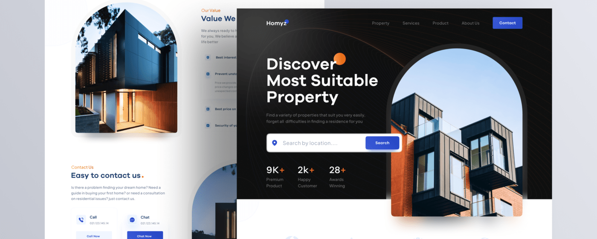

[](https://homyz.himaiz.com/)

# Homyz Real Estate

Introducing Homyz - the ultimate real estate platform! Buy or sell properties hassle-free with its user-friendly interface. List your property effortlessly, and explore countless options with a dynamic interactive map. Like your favourite residencies and secure your account with Auth0. Sleek UI powered by Mantine for a seamless experience. Get ready for the real estate adventure of a lifetime!

## Deployment

Homyz Real Estate is live at [**homyz.himaiz.com**](https://homyz.himaiz.com/).

- **Web:** the Vite build is served by the Cloudflare Worker `homyz-web` (Workers static assets, `client/wrangler.toml`, security headers in `client/public/_headers`). Deploy from `client/` with `CLOUDFLARE_API_TOKEN` set: `npm run deploy`.
- **API:** `api.homyz.himaiz.com` is the Cloudflare Worker `homyz-api-edge` (`edge/api/`), which forwards to the Vercel project `homyz-real-estate-backend`. It adds a shared secret (`X-Origin-Auth`) and the visitor's address (`X-Client-IP`). With `ORIGIN_AUTH` set and `ORIGIN_AUTH_MODE=enforce`, the API refuses requests that skip Cloudflare (403), except Vercel's own cron call to `/api/keepalive`. The rate limiter trusts `X-Client-IP` only when the secret matches.
- Both hostnames sit behind the `himaiz.com` zone's Cloudflare WAF. The backend still deploys from Vercel on push to `main`.

## Key Features

- **Discover Dream Properties**: Uncover your perfect home with Homyz's powerful property search. Explore any location and its surroundings on an interactive map.
- **Love It, Save It**: Fall in love with properties? Simply hit the heart button to save them to your personalized favourites list for future delight.
- **Fortress of Security**: Your data is guarded by Auth0, ensuring a rock-solid and seamless user authentication experience.
- **Unlock Exclusive Features**: Create an account, log in, and open the door to exclusive features, saving preferences, and personalized experiences.

## Technologies


- **React**: Empowering UI Magic. A dynamic JavaScript library for creating captivating user interfaces with ease.
- **Node.js**: Unleashing Server-Side Potential. A powerful runtime environment enabling lightning-fast back-end development.
- **Express**: Streamlined Web Applications. An agile Node.js framework simplifying server-side coding for web applications.
- **MongoDB**: Rock-Solid Data Storage. A cutting-edge NoSQL database ensuring secure and reliable data storage.
- **Auth0**: Fortified Authentication. A top-tier third-party service providing robust user authentication for enhanced security.
- **Mantine**: Beauty in UI Components. A treasure trove of React components for crafting polished and stunning user interfaces.

## Run on Local Machine

1. Clone the repository and install dependencies:

```bash
git clone https://github.com/maiznadeem/HomyzRealEstate.git
cd HomyzRealEstate
cd client && npm install
cd ../server && npm install
```

2. Create `server/.env`:

```
PORT=8000
DATABASE_URL=your_mongodb_url_here
CORS_ORIGINS=http://localhost:3000
CLOUDINARY_API_KEY=your_cloudinary_api_key
CLOUDINARY_API_SECRET=your_cloudinary_api_secret
CRON_SECRET=a_long_random_string
```

   `CORS_ORIGINS` lists the sites allowed to call the API (default: the deployed site only). `ORIGIN_AUTH` and `ORIGIN_AUTH_MODE` are production-only (see Deployment); leave them unset locally. The Cloudinary key signs image uploads; without it, property image uploads are disabled. Optional overrides: `CLOUDINARY_CLOUD_NAME` (default `dwujonydh`), `AUTH0_ISSUER_BASE_URL` (default `https://homyz-real-estate.us.auth0.com`) and `AUTH0_AUDIENCE` (default `https://homyz-real-estate-backend.vercel.app/`).

3. Create `client/.env.local` to point the client at your local server:

```
VITE_API_BASE_URL=http://localhost:8000/api
```

   `VITE_AUTH0_DOMAIN`, `VITE_AUTH0_CLIENT_ID` and `VITE_AUTH0_AUDIENCE` override the defaults in `client/config.js` if you use your own Auth0 tenant.

4. Start both apps:

```bash
cd server && npm run dev
cd client && npm run dev
```

5. Open `http://localhost:3000`. The API runs on `http://localhost:8000`.

   Deployed environments allow only production origins. The site's Auth0 application and the API's CORS list contain only the production site, and Vercel preview deployments can't call the production API. Don't add `localhost` to the production Auth0 application. To log in locally, create a separate development application (or tenant) that allows `http://localhost:3000`, and point the `VITE_AUTH0_*` variables in `client/.env.local` at it. Browsing listings works locally without logging in.

### Auth0 setup

The client logs in with the Auth0 SPA application and requests an access token for the **Homyz Real Estate** API (`https://homyz-real-estate-backend.vercel.app/`). A post-login Action, *Homyz Real Estate - email claim*, adds the user's verified email to that token as `https://homyz-real-estate/email`, and the server uses that claim, never an email sent in the request, to decide whose favourites and bookings to read or change. A second post-login Action, *Homyz Real Estate - link accounts by email*, runs first and keeps one account per person: when someone logs in with a verified email that another verified account already uses (for example Google and then email + password), it links the two into the oldest account. The site's tenant is `homyz-real-estate.us.auth0.com`. If you use your own tenant:

- Add your deployed URL to the application's Allowed Callback URLs, Allowed Logout URLs and Allowed Web Origins. Use a separate development application for `http://localhost:3000`.
- Create an API, enable **Allow Offline Access** (the client uses refresh tokens), and use its identifier as the audience.
- Create the post-login Action that sets the `https://homyz-real-estate/email` claim for verified emails.

### Database

The server uses Prisma with MongoDB Atlas on the free M0 tier. Atlas pauses free clusters after long inactivity, so a daily Vercel cron (`crons` in `server/vercel.json`) calls `GET /api/keepalive`, which runs one small query. Vercel sends `Authorization: Bearer $CRON_SECRET`; without `CRON_SECRET` set the endpoint always returns 401. If the site still shows "Something went wrong" while loading properties, resume the cluster in Atlas.

Use a database user limited to the app's database (role `readWrite` on `Homyz-Database`), not one with access to every database on the cluster.

### Security and abuse limits

- **Accounts:** every user action needs an Auth0 access token whose verified email the server reads from the token. Unverified emails can browse but not act.
- **Image uploads:** property photos upload straight to Cloudinary through the signed preset `homyz_property_images`, which stores them in the *Homyz Real Estate* folder, accepts only jpg, png and webp, and caps them at 2000 px. The API (`POST /api/upload/signature`) signs each upload only for a logged-in user, only for that preset and folder, only for an upload starting now, and only once per random image id; the preset never overwrites, so a replayed signature cannot create a second image.
- **Rate limits** (shared across serverless instances through a `RateLimit` collection in MongoDB that expires on its own): 300 API requests per 15 minutes per IP; 120 signed-in actions per 15 minutes per account; 5 new properties per day per account and 15 per IP; 15 image uploads per hour per account and 40 per IP.
- **Data caps:** at most 20 properties, 200 favourites and 50 bookings per account, and favourites and bookings must point at real properties.
- **Validation:** property fields have length and range limits, prices and room counts must be whole numbers, visit dates must fall within the next year, and property images must be Cloudinary URLs from the site's folder.
- **Headers and CORS:** `helmet` sets security headers on the API and `client/public/_headers` sets a CSP and other headers on the site; browsers may only call the API from the deployed site, and request bodies are limited to 20 KB.
- **Origin lock:** the API only answers requests that came through Cloudflare (see Deployment).
- **Privacy:** public property reads don't include the owner's email address.

**Contributing**

Contributions to this project are welcomed. If you wish to contribute, please follow the standard GitHub workflow by creating pull requests and discussing any proposed changes via issues.

**Reporting Issues**

If you encounter any issues while using the Homyz website or have any suggestions for improvement, please open an issue on the GitHub repository. Your feedback is valuable to us, and we will address any reported issues promptly.

---

## Contact

Maiz - contact.maiznadeem@gmail.com

Project Link: [View Github](https://github.com/maiznadeem/HomyzRealEstate)